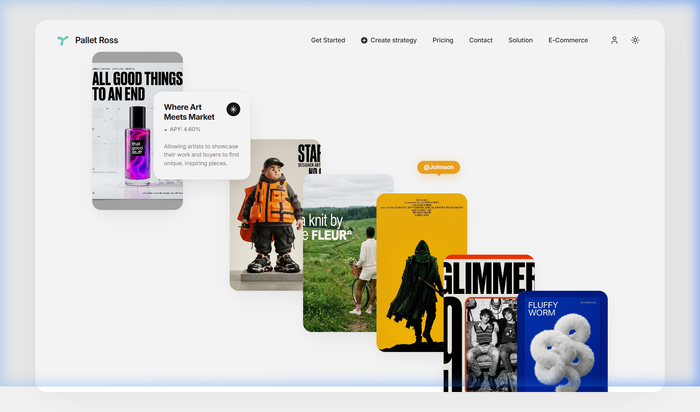

# Pallet Ross — Creative Editorial Landing Page & Art Protocol Template

[](LICENSE)
[](https://www.typescriptlang.org/)
[](https://react.dev/)
[](https://vitejs.dev/)
[](https://github.com/dmsda/webs)

> A production-ready, open-source creative landing page and digital art protocol template. Built with extreme fidelity to high-end editorial aesthetics, featuring a diagonal hero art gallery, interactive APY strategy simulator, filterable exhibition rails, curatorial board, and multi-viewport responsiveness.

**GitHub Repository**: [https://github.com/dmsda/webs](https://github.com/dmsda/webs)

---

## 📸 Preview



*Desktop Hero Artboard (1440 × 900 baseline) featuring cascading diagonal artworks, floating editorial card, and precision metadata tags.*

---

## 📖 Overview

**Pallet Ross** bridges the worlds of high-end editorial design, contemporary digital art, and transparent protocol economics. Built from ground-truth visual references and motion storyboards, the project demonstrates how luxury Swiss editorial typography, disciplined white-space composition, and modern web technologies unite to form a premier landing experience.

Key design attributes:
- **Floating Artboard Canvas**: Centered container with 24px border radii, subtle ambient diffusion shadows, and fluid viewport clamping.
- **Diagonal Staggered Hero Composition**: 6 high-resolution artworks cascading across controlled depth layers and overlapping z-indices.
- **Dynamic Yield Mechanics**: Interactive client-side APY simulator calculating real-time compounding protocol yields.
- **Full-Content Narrative**: Seamlessly transitions from high-concept hero artwork to exhibition catalogues, institutional solutions, transparent pricing tiers, and artist submissions.

---

## ✨ Features

- **Diagonal Hero Art Gallery (`#hero`)**:
  - 6 high-resolution artworks staged diagonally from top-left to bottom-right.
  - Floating Info Card (*Where Art Meets Market • APY: 4.60%*).
  - Floating Tag (`@Johnson`) with speech-bubble pointer directing to Poster 4.
  - Geometric turquoise propeller brand mark and dual-theme switcher.
- **Protocol & Strategy Architecture (`#strategy`)**:
  - Interactive APY Strategy Simulator with real-time vault allocation slider ($1,000 to $100,000).
  - Dynamic 4.60% APY return calculator (annual yield, monthly distribution, and tier tiering).
  - Three core protocol pillars: Automated Royalty Splitting, Dynamic Bonding Curves, and Fractional Vaulting.
- **Autumn 2024 Showcase Exhibition (`#exhibition`)**:
  - Full-width grid exhibiting all 7 original artworks.
  - Interactive filter pills (*All, Editorial Design, Collectible Art, Campaign Photography, Film Poster, Music Periodical, 3D Digital Sculpture*).
  - Hover elevation with edition metadata and click-to-open lightbox inspect dialogs.
- **Creator & Institutional Solutions (`#solution`)**:
  - Dual-track comparison: Independent Artists vs. Museums & Foundations.
  - Global logistics, bonded vaulting, and NFC cryptographic provenance metrics.
- **Transparent Economics & FAQs (`#pricing`)**:
  - 3 structured tiers: *Collector Pass ($0)*, *Curated Artist (1.5%)*, and *Institutional Gallery ($490/mo)*.
  - Interactive expandable FAQ accordion with smooth CSS chevron animations.
- **Curatorial Board Spotlight (`#curators`)**:
  - Profiles for `@Johnson` (Lead Visual Curator), Elena Rostova (Head of Contemporary Acquisitions), and Marcus Chen (Yield Architect).
- **Artist & Curator Submissions (`#contact`)**:
  - Interactive portfolio submission form with discipline selectors and live feedback confirmation.
- **Luxury Editorial Footer**:
  - Newsletter dispatch with instant confirmation, live Ethereum L1 network status badge, and legal links.
- **Light & Dark Theme Engine**:
  - Instant toggle between crisp warm white (`#F1F1F1` / `#FFFFFF`) and sleek charcoal (`#0D0E10` / `#16171A`).
- **Responsive Multi-Device Layout**:
  - Desktop (1440px+), Tablet (768px–1199px), and Mobile (<768px) with horizontal swipeable artwork rails.

---

## 🛠 Technology Stack

| Layer | Technology | Rationale |
|---|---|---|
| **Core Framework** | [React 18.3](https://react.dev/) | Declarative component tree and optimized virtual DOM rendering |
| **Build & Tooling** | [Vite 6.0](https://vitejs.dev/) | Sub-second HMR and optimized Rollup production builds |
| **Language** | [TypeScript 5.6](https://www.typescriptlang.org/) | Strict type safety (`strict: true`, `noUnusedLocals: true`) |
| **Styling** | Vanilla CSS Design System | CSS custom properties (tokens), CSS Grid, zero utility bloat |
| **Icons** | [Lucide React](https://lucide.dev/) | Clean, accessible vector iconography |
| **Asset Formats** | High-Resolution WebP & Vector SVG | Ultra-fast image decoding and responsive scaling without layout shifts |

---

## 📂 Project Structure

```text
pallet-ross/
├── public/
│   ├── assets/
│   │   ├── artworks/           # 7 WebP high-resolution posters
│   │   └── brand/              # Vector SVG brand logo
│   └── favicon.svg             # Standalone favicon icon
├── src/
│   ├── components/             # Reusable UI components
│   │   ├── sections/           # Landing page sections (#hero, #strategy, etc.)
│   │   ├── ArtworkCard.tsx     # Poster component with hover states
│   │   ├── BrandLogo.tsx       # Propeller logo mark and wordmark
│   │   ├── FloatingInfoCard.tsx# Overlapping hero metadata card
│   │   ├── FloatingTag.tsx     # Pointer pill tag
│   │   ├── HeroGallery.tsx     # Diagonal artboard composition
│   │   ├── ModalPreview.tsx    # Contextual lightbox modal
│   │   ├── NavigationMenu.tsx  # Header navigation & mobile drawer
│   │   ├── SiteHeader.tsx      # Top bar layout coordinator
│   │   └── ThemeToggle.tsx     # Dark/light theme switch
│   ├── data/
│   │   ├── artworks.ts         # Visual asset definitions and metadata
│   │   └── navigation.ts       # Links, FAQ items, and protocol metrics
│   ├── styles/
│   │   ├── tokens.css          # Central design system tokens
│   │   ├── global.css          # CSS reset, typography, and base layout
│   │   ├── hero-gallery.css    # Hero artboard grid & card positioning
│   │   └── landing-sections.css# Full-content section styles
│   ├── App.tsx                 # Root layout & modal coordinator
│   └── main.tsx                # Application mounting entry point
├── docs/                       # Technical architecture & audit reports
│   ├── images/                 # Preview screenshots
│   ├── references/             # Visual reference baselines and test renders
│   ├── ARCHITECTURE.md         # Component hierarchy and data flow
│   ├── DESIGN_SPEC.md          # Visual tokens, spacing, and geometry
│   ├── ASSET_MANIFEST.md       # Visual asset catalog & licensing
│   ├── CLEANUP_REPORT.md       # Audit ledger of cleaned/retained files
│   ├── DEPLOYMENT.md           # Hosting guides (Vercel, Netlify, Cloudflare)
│   └── TEST_REPORT.md          # Testing matrices & QA validation
├── .github/
│   ├── ISSUE_TEMPLATE/         # Bug report & feature request templates
│   ├── workflows/ci.yml        # GitHub Actions CI workflow
│   └── PULL_REQUEST_TEMPLATE.md# Pull request template
├── .editorconfig               # Workspace indentation standards
├── .env.example                # Safe environment configuration template
├── .gitignore                  # Git tracking exclusion rules
├── CHANGELOG.md                # Release history
├── CONTRIBUTING.md             # Contributor guidelines
├── CODE_OF_CONDUCT.md          # Contributor Covenant v2.1
├── LICENSE                     # MIT License & asset terms
├── package.json
├── package-lock.json
├── tsconfig.json
└── vite.config.ts
```

---

## 📋 Prerequisites

Before running the project locally, ensure you have installed:
- **Node.js**: `v18.0.0` or higher (`node -v`)
- **npm**: `v9.0.0` or higher (`npm -v`)

---

## 🚀 Installation & Template Setup

1. Clone the open-source repository:
   ```bash
   git clone https://github.com/dmsda/webs.git
   cd webs
   ```
2. Install exact dependencies from the lockfile:
   ```bash
   npm ci
   ```
   *(or run `npm install` if adapting dependencies for your own fork)*

---

## 💻 Local Development

Start the local Vite development server:
```bash
npm run dev
```
Open [http://localhost:5173](http://localhost:5173) in your browser. The server supports hot module replacement (HMR).

---

## 📦 Production Build

To compile and validate the optimized production bundle:
```bash
# 1. Type-check TypeScript files without emitting files
npm run typecheck

# 2. Build production assets into dist/
npm run build

# 3. Preview the production build locally
npm run preview
```

### Production Build Footprint
```text
dist/index.html                   1.04 kB │ gzip:  0.56 kB
dist/assets/index.css            30.37 kB │ gzip:  6.06 kB
dist/assets/index.js            200.92 kB │ gzip: 61.41 kB
Total Gzipped Production Payload: < 68 kB
Build Duration: ~1.3 seconds
```

---

## 🎨 Customization Guide

### 1. Brand & Wordmark
- Change the brand name in `src/components/BrandLogo.tsx`.
- Modify the vector logo curves in `public/assets/brand/logo.svg` or `src/components/BrandLogo.tsx`.

### 2. Design Tokens & Palette
- All colors, radii, shadows, and animations are managed in `src/styles/tokens.css`.
- Update `--bg-panel`, `--accent-turquoise`, or `--radius-panel` to instantly re-theme the entire application.

### 3. Artwork Data & Posters
- Artwork metadata (titles, artists, medium, pricing, tags) is defined in `src/data/artworks.ts`.
- Place new images in `public/assets/artworks/` (WebP recommended for optimal performance) and register them in `src/data/artworks.ts`.

### 4. Navigation Links & Sections
- Navigation links and scroll anchors are maintained in `src/data/navigation.ts`.
- Sections are modular organisms located in `src/components/sections/` and can be reordered or customized in `src/App.tsx`.

---

## 🖼 Assets & Attribution

- **Artworks**: All 7 editorial artworks located in `public/assets/artworks/` are original assets created specifically for this project and distributed under Creative Commons Zero (CC0).
- **Icons**: Icons are provided by [Lucide React](https://lucide.dev/) (ISC License).
- **Fonts**: [Inter](https://fonts.google.com/specimen/Inter) designed by Rasmus Andersson (SIL Open Font License 1.1).
- For complete details on dimensions, checksums, and licensing, refer to [`docs/ASSET_MANIFEST.md`](docs/ASSET_MANIFEST.md).

---

## 🚢 Deployment

The repository builds to standard static files in `dist/` and deploys seamlessly to static hosting platforms:
- **Vercel**: Framework preset `Vite`, build command `npm run build`, output directory `dist`.
- **Netlify**: Publish directory `dist`, build command `npm run build`.
- **Cloudflare Pages**: Framework preset `Vite`, output directory `dist`.
- **GitHub Pages**: Build action configured via `.github/workflows/ci.yml`.

For detailed step-by-step hosting walkthroughs, consult [`docs/DEPLOYMENT.md`](docs/DEPLOYMENT.md).

---

## 🧪 Testing & Validation

Run the verification suite:
```bash
# Strict TypeScript compilation
npm run typecheck

# Full production build
npm run build
```
For audit logs across desktop (1440 × 900), tablet (1024 × 768), and mobile (390 × 844 / 360 × 800) viewports, see [`docs/TEST_REPORT.md`](docs/TEST_REPORT.md).

---

## 🤝 Contributing

Contributions, bug reports, and suggestions are welcome! Please read [`CONTRIBUTING.md`](CONTRIBUTING.md) and [`CODE_OF_CONDUCT.md`](CODE_OF_CONDUCT.md) before submitting pull requests.

---

## 📄 License

This repository's source code is licensed under the [MIT License](LICENSE).
Visual artworks and brand assets are subject to the terms documented in [`docs/ASSET_MANIFEST.md`](docs/ASSET_MANIFEST.md).

---

## 🙏 Acknowledgements

- Visual design and composition inspired by high-end editorial and decentralized contemporary art platforms.
- Motion dynamics referencing experimental digital art showcases.
