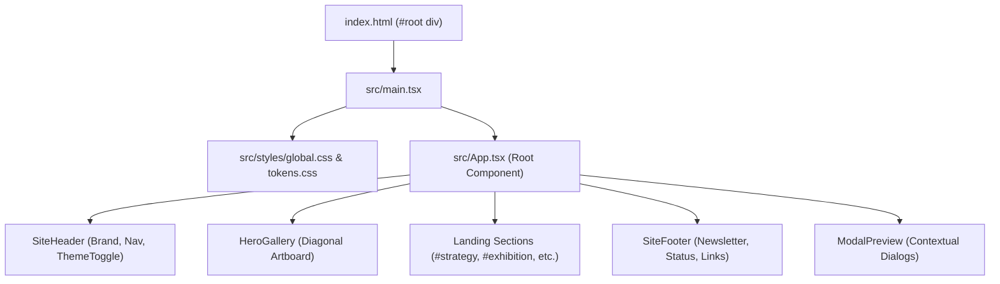
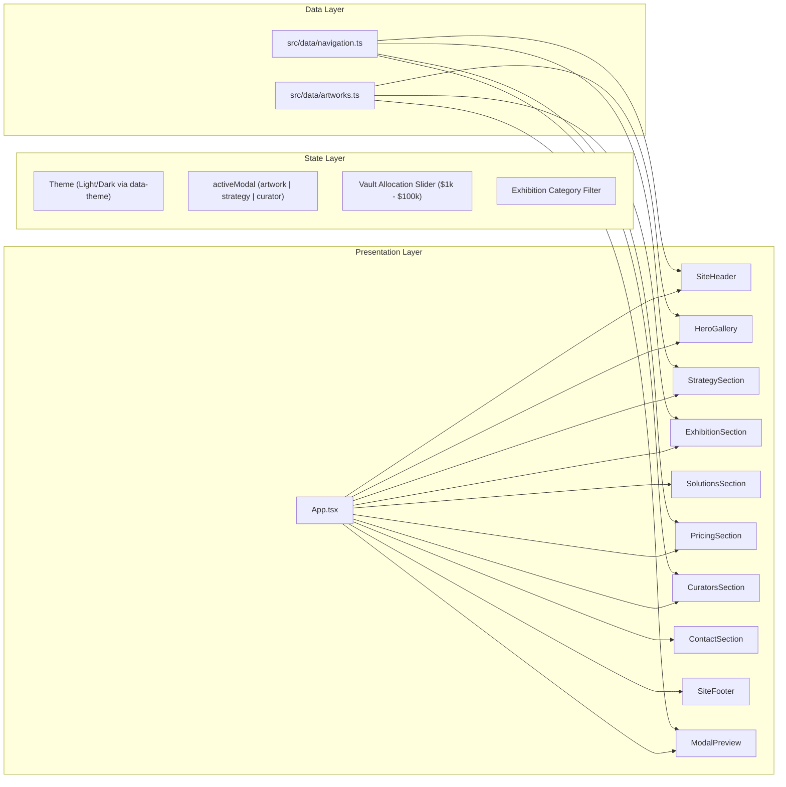

# ARCHITECTURE.md — Pallet Ross Architectural Design

## 1. System Overview
Pallet Ross is an editorial creative landing page and digital art protocol showcase designed with millimeter-precise visual fidelity to reference specifications. The architecture prioritizes:
- **Instant First Paint & Ultra-Lightweight Payload**: Sub-68 kB gzipped bundle without bulky UI frameworks or utility class compilers.
- **Pure Vanilla CSS Design System**: Centralized design tokens (`src/styles/tokens.css`) driving atomic and compound components.
- **Hardware-Accelerated Motion**: 60fps transform and opacity transitions with reduced-motion fallbacks.
- **Zero Runtime Secret Dependencies**: Self-contained client-side single page application (SPA).

---

## 2. Directory Hierarchy & Code Organization

```text
pallet-ross/
├── public/
│   ├── assets/
│   │   ├── artworks/           # 7 High-resolution WebP posters
│   │   └── brand/              # Vector SVG propeller logo
│   └── favicon.svg             # Standalone favicon icon
├── src/
│   ├── components/             # Atomic & compound UI components
│   │   ├── sections/           # Full-content landing page sections
│   │   │   ├── ContactSection.tsx
│   │   │   ├── CuratorsSection.tsx
│   │   │   ├── ExhibitionSection.tsx
│   │   │   ├── PricingSection.tsx
│   │   │   ├── SiteFooter.tsx
│   │   │   ├── SolutionsSection.tsx
│   │   │   └── StrategySection.tsx
│   │   ├── ArtworkCard.tsx     # Poster card with hover elevation
│   │   ├── BrandLogo.tsx       # Vector brand mark with wordmark
│   │   ├── FloatingInfoCard.tsx# Overlapping editorial card
│   │   ├── FloatingTag.tsx     # @Johnson pill tag with pointer
│   │   ├── HeroGallery.tsx     # Diagonal hero artboard container
│   │   ├── ModalPreview.tsx    # Lightbox modal for artworks/curators
│   │   ├── NavigationMenu.tsx  # Header navigation & mobile drawer
│   │   ├── SiteHeader.tsx      # Top bar layout coordinator
│   │   └── ThemeToggle.tsx     # Light/Dark mode switcher
│   ├── data/
│   │   ├── artworks.ts         # Visual asset metadata, editions, prices
│   │   └── navigation.ts       # Navigation links, FAQ data, stats
│   ├── styles/
│   │   ├── tokens.css          # Color, radius, elevation CSS tokens
│   │   ├── global.css          # Reset, font loading, layout base
│   │   ├── hero-gallery.css    # Hero artboard grid & card placement
│   │   └── landing-sections.css# Full-content section styles
│   ├── App.tsx                 # Root layout & global modal state
│   └── main.tsx                # React DOM 18 mounting entry point
├── docs/                       # Specifications, audits, and manifests
├── .github/                    # CI workflows and issue templates
├── .gitignore
├── .env.example
├── CONTRIBUTING.md
├── CODE_OF_CONDUCT.md
├── LICENSE
├── README.md
├── package.json
├── package-lock.json
├── tsconfig.json
└── vite.config.ts
```

---

## 3. Application Entry Point & Mounting Flow



1. **`index.html`**: Pre-connects to Google Fonts (`Inter`), establishes meta viewport and SEO descriptions, and loads `/src/main.tsx`.
2. **`main.tsx`**: Imports design tokens and global reset styles, mounts the root React tree via `ReactDOM.createRoot`.
3. **`App.tsx`**: Manages global modal state (`activeModal`), theme state (`light` / `dark`), and coordinates seamless scroll-spying between the navigation bar and document anchors.

---

## 4. Component Hierarchy & Data Flow



### State Management Strategy
- **Zero Redux/Zustand Bloat**: State is scoped strictly where needed via native React hooks (`useState`, `useEffect`, `useCallback`).
- **Theme Persistence**: Light and Dark modes switch using `document.documentElement.setAttribute('data-theme', mode)` and are saved in `localStorage`.
- **Lightbox / Modal Dispatch**: Centralized `handleOpenModal(modalData)` in `App.tsx` allows any section (Hero, Exhibition, Curators) to trigger detailed inspection modals without prop drilling.

---

## 5. Styling System & Design Tokens
All visual properties are defined once in `src/styles/tokens.css` as CSS custom properties:
- **Surface Elevation**: `--bg-viewport`, `--bg-panel`, `--bg-card`
- **Typography Colors**: `--text-primary`, `--text-secondary`, `--text-tertiary`, `--text-inverse`
- **Accents**: `--accent-turquoise`, `--accent-yellow`, `--accent-orange`, `--accent-purple`, `--accent-blue`
- **Geometry**: `--radius-panel (24px)`, `--radius-card (18px)`, `--radius-tag (9999px)`
- **Shadows**: Ultra-subtle diffusion curves that scale between light and dark modes.

---

## 6. Asset Management & Delivery
- **High-Resolution WebP**: Posters are stored locally in `public/assets/artworks/` with explicit width/height to eliminate layout shifts (CLS = 0).
- **Scalable Vector Graphics (SVG)**: Brand logos and geometric icons use inline or local SVG to ensure tack-sharp fidelity on high-DPI screens.
- **Zero External Asset Dependency**: Artwork assets do not rely on external CDNs or unverified third-party hosts.

---

## 7. Responsive & Layout Strategy
- **Desktop (>=1200px)**: Centered 1440px artboard panel with diagonal staggered 6-poster composition, floating card, and speech-bubble tag.
- **Tablet (768px - 1199px)**: Fluid clamping with preserved diagonal rhythm, responsive two-column grids.
- **Mobile (<768px)**:
  - Header transforms into a clean hamburger menu drawer.
  - Hero gallery shifts to a touch-scrollable horizontal artwork rail.
  - Simulator and solution cards stack into clean, thumb-friendly single columns.

---

## 8. Current Architectural Limitations & Future Evolution
1. **Mock Endpoints**: Contact and newsletter submissions currently simulate asynchronous network requests locally without a live backend database.
2. **Static Asset Index**: Artwork metadata is loaded from local TypeScript definitions (`artworks.ts`) rather than a headless CMS or GraphQL endpoint.
3. **Web3 Connectivity**: APY simulator calculates dynamic compounding yields mathematically in client-side TypeScript; wallet connection (`wagmi` / `viem`) can be integrated as an opt-in layer.
